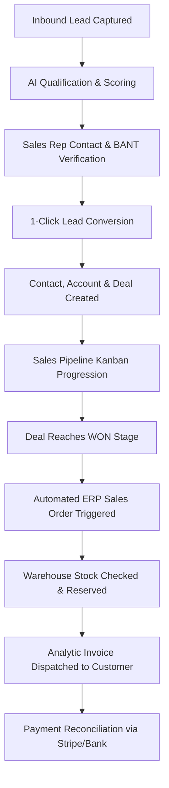
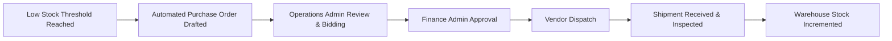
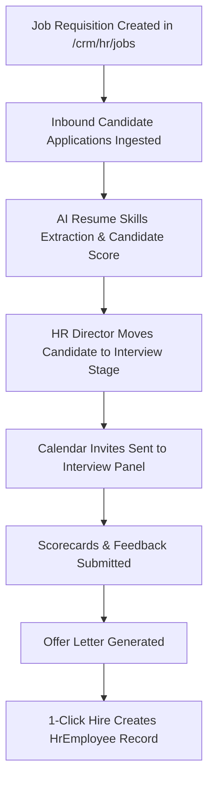
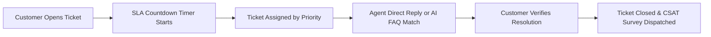

# CRM nErgy Business Workflows & Autonomous Protocols

Step-by-step documentation of verified cross-module workflows and autonomous AI execution sequences in CRM nErgy.

---

## 1. LEAD-TO-CASH SALES & OPERATIONS WORKFLOW



### 1.1 Detailed Operational Steps:
1. **Lead Ingestion:** Inbound lead arrives via Website form, cold outreach campaign, referral, or AI inbound voice agent.
2. **AI Qualification:** Lead receives an automated score (0-100) based on title, company size, and budget alignment.
3. **Contact & Pipeline:** Assigned sales rep conducts discovery calls; moves deal through Kanban (`CONTACTED` -> `QUALIFIED` -> `PROPOSAL` -> `NEGOTIATION`).
4. **Deal Won:** When status moves to `WON`, the system automatically generates an active `ErpProject` for onboarding, provisions an initial invoice draft, and decrements warehouse stock.

---

## 2. REQUISITION-TO-PAYMENT PROCUREMENT WORKFLOW



### 2.1 Detailed Operational Steps:
1. **Trigger:** Inventory item quantity on hand drops below `reorderThreshold`.
2. **Requisition:** A draft purchase order (`DRAFT`) is generated specifying the required quantity and preferred vendor.
3. **Approval:** Operations Admin submits order for review; Finance Admin approves commercial terms.
4. **Reception:** When goods arrive at the loading dock, receiving staff inspects items and clicks **"Receive Shipment"**, which immediately updates `quantityOnHand` in `InventoryItem`.

---

## 3. TALENT REQUISITION & ATS CANDIDATE WORKFLOW



---

## 4. CUSTOMER SUPPORT RESOLUTION & SLA ESCALATION



---

## 5. ZUNME AI / BESTIE AI JSON ACTION EXECUTION PROTOCOL

When the user gives natural language instructions to **Zunme AI**, the AI parses intent into strict executable JSON action blocks:

### 5.1 Create Lead Action:
```json
{
  "action": "CREATE_LEAD",
  "parameters": {
    "name": "Sarah Connor",
    "email": "sarah@cyberdyne.com",
    "company": "Cyberdyne Systems",
    "estimatedValue": 75000,
    "source": "AI_AGENT"
  }
}
```

### 5.2 Update Deal Stage Action:
```json
{
  "action": "UPDATE_DEAL_STAGE",
  "parameters": {
    "dealId": "deal_xyz123",
    "newStage": "PROPOSAL",
    "note": "Proposal delivered via email with 15% annual commitment discount."
  }
}
```

### 5.3 Schedule Task Action:
```json
{
  "action": "SCHEDULE_TASK",
  "parameters": {
    "title": "Quarterly Business Review with Acme Corp",
    "dueDate": "2026-11-15T10:00:00Z",
    "priority": "HIGH",
    "assignedTo": "user_sales_lead"
  }
}
```

### 5.4 Check Inventory Action:
```json
{
  "action": "CHECK_INVENTORY",
  "parameters": {
    "sku": "SOLAR-INV-5KW"
  }
}
```
